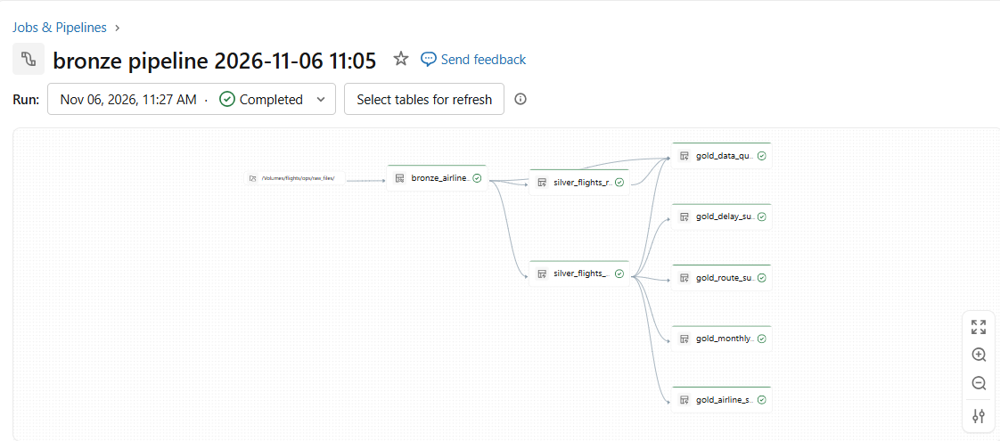
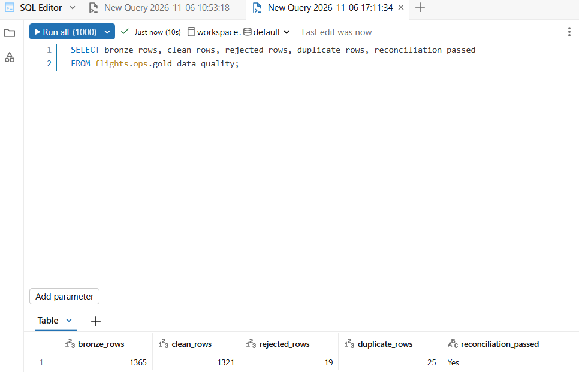
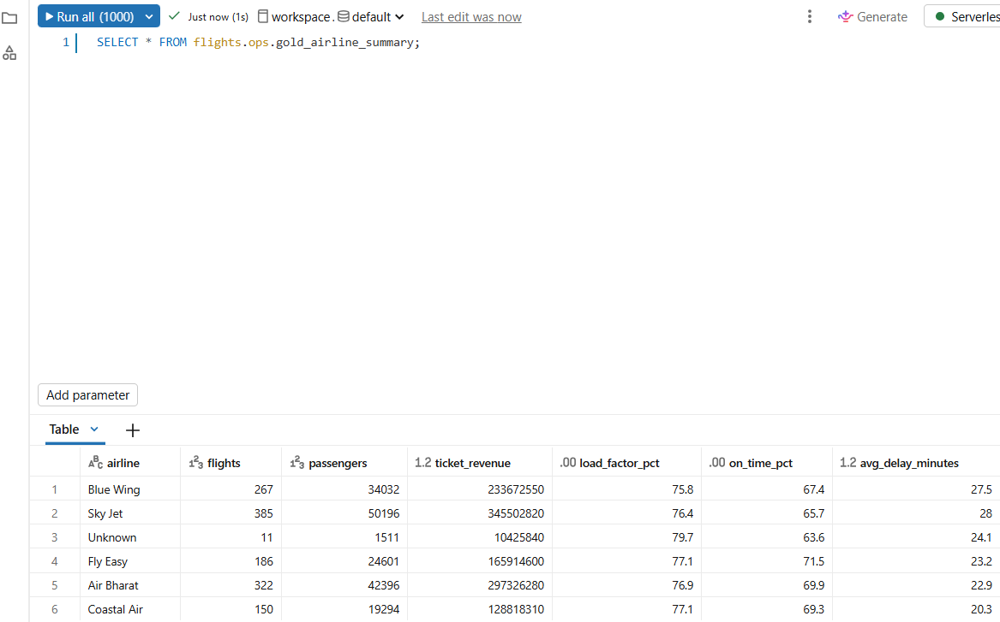
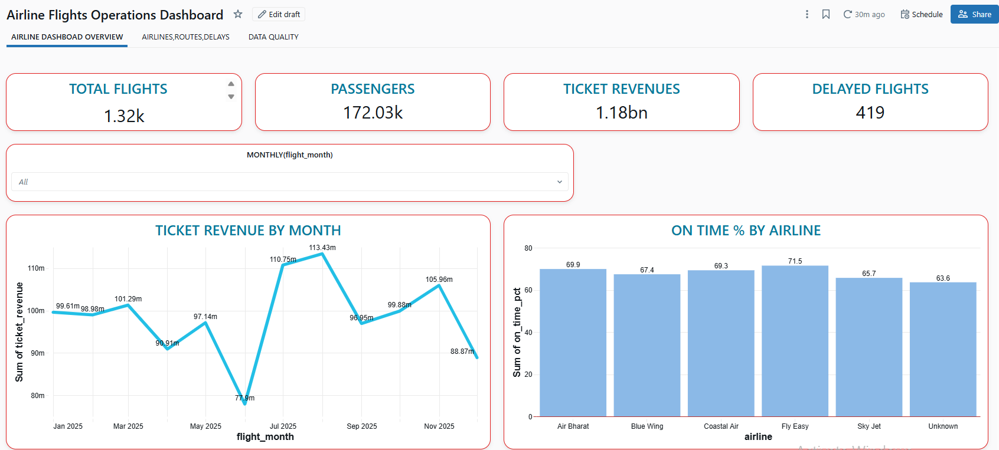

# Airline Flight Operations Analytics

A Databricks Medallion pipeline (Bronze, Silver, Gold) built with Lakeflow Spark Declarative Pipelines in SQL, plus a 3-page AI/BI dashboard. It turns a raw airline flights CSV (1,365 rows) into trusted summary tables and proves that no row was lost.

**Tools:** Databricks, Unity Catalog, Lakeflow Spark Declarative Pipelines (SQL), Databricks AI/BI

## Business problem

An airline operations team exports every domestic flight to a CSV file. The file has extra spaces, inconsistent capital letters, blank values, duplicate flights, flights with more passengers than seats and negative fares. Managers need reliable numbers for flights, passengers, ticket revenue, load factor and delays by airline and route.

## Architecture

Source CSV (Unity Catalog Volume) -> Bronze -> Silver (clean + rejected) -> Gold -> AI/BI Dashboard

| Layer | Table | Purpose |
|---|---|---|
| Bronze | `bronze_airline_flights` | Raw rows plus source file name and load time |
| Silver | `silver_flights_clean` | Deduplicated, standardised flights with a delay category |
| Silver | `silver_flights_rejected` | Overbooked or negative-fare flights with a reject reason |
| Gold | `gold_monthly_flights` | Flights, passengers, load factor, revenue, fuel cost and delayed flights per month |
| Gold | `gold_airline_summary` | Flights, revenue, load factor, on-time % and average delay per airline |
| Gold | `gold_route_summary` | Flights, passengers, revenue and load factor per route |
| Gold | `gold_delay_summary` | Flights and average delay by delay category and reason |
| Gold | `gold_data_quality` | Problem counts and the reconciliation check |

## Pipeline

Bronze keeps the raw data, Silver cleans it and quarantines bad rows, and Gold builds the summary tables. The full pipeline code is in `airline_flights_pipeline.sql`.

## Data cleaning rules

| Problem | Rows | Rule | Why |
|---|---|---|---|
| Duplicate flights | 25 | `SELECT DISTINCT` | `flight_id` must be unique |
| Extra spaces, mixed case | many | `INITCAP(TRIM(col))` | Group names consistently |
| Blank airline | 11 | `COALESCE` to 'Unknown' | Keep the flight and show the gap |
| Blank delay reason | 12 | `COALESCE` to 'Unknown' | Keep the flight and show the gap |
| Blank delay minutes | 18 | `TIMESTAMPDIFF` of the two departure times | The value can be calculated |
| Blank ticket revenue | 16 | passengers x avg_fare | The formula defines revenue |
| Blank aircraft ID | 9 | Row kept unchanged | Revenue and delay are still valid |
| Passengers above seats | 11 | Moved to the rejected table with a reason | Physically impossible |
| Negative average fare | 8 | Moved to the rejected table with a reason | Invalid value |
| Negative delay minutes | - | Kept, counted as On Time | The flight left early |

**Delay category:** 15 minutes or less is On Time, 16 to 60 is Minor Delay, more than 60 is Major Delay.

## Data quality and reconciliation

**1,365 Bronze rows = 1,321 clean + 19 rejected + 25 duplicates removed.** The `gold_data_quality` table returns `reconciliation_passed = Yes`.

## Gold table example

## Dashboard

Built in Databricks AI/BI on the Gold tables only.

### Page 1: Overview

1,321 flights, 172,030 passengers, 118.17 crore ticket revenue and 419 delayed flights, with revenue by month and on-time % by airline.

### Page 2: Airlines, Routes and Delays

Airline performance table, top 10 routes by revenue, flights by delay category (On Time 902, Minor 284, Major 135) and delayed flights by reason.

### Page 3: Data Quality

Bronze, clean, rejected and duplicate row counts, the reconciliation check and a bar chart of the issues found.

## Key results

- Fly Easy has the best on-time performance
